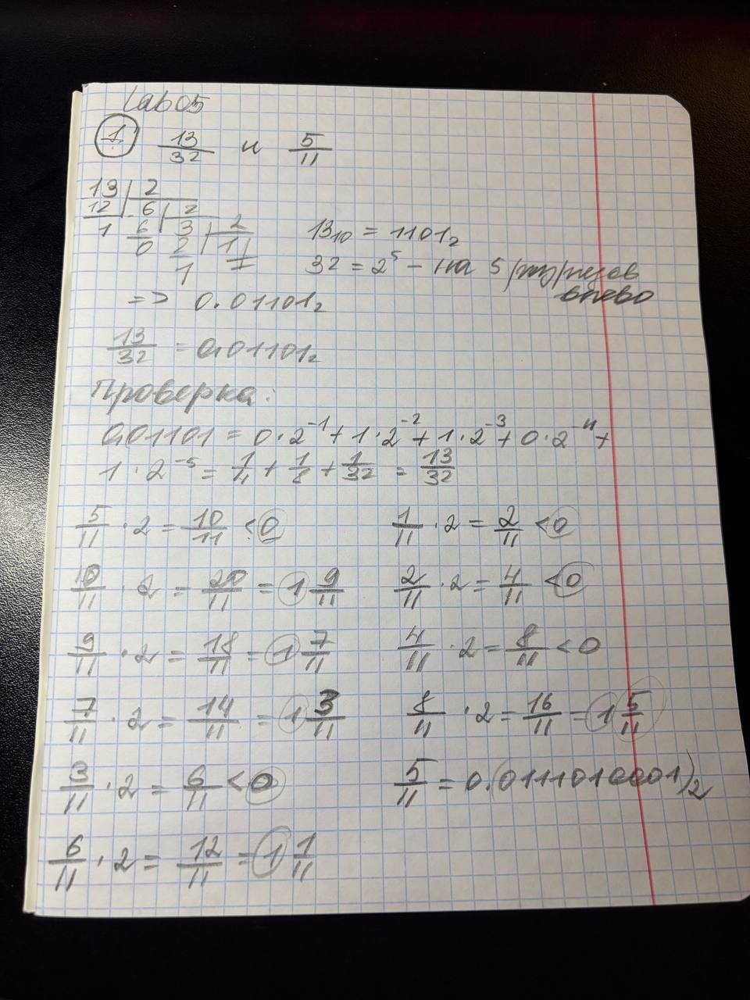
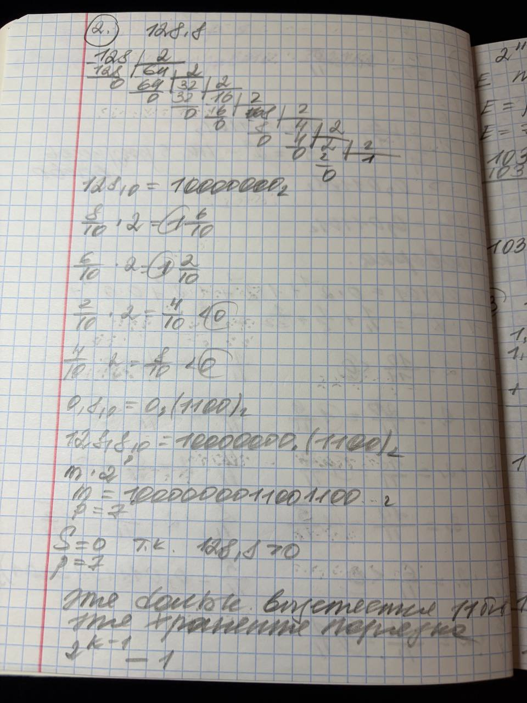
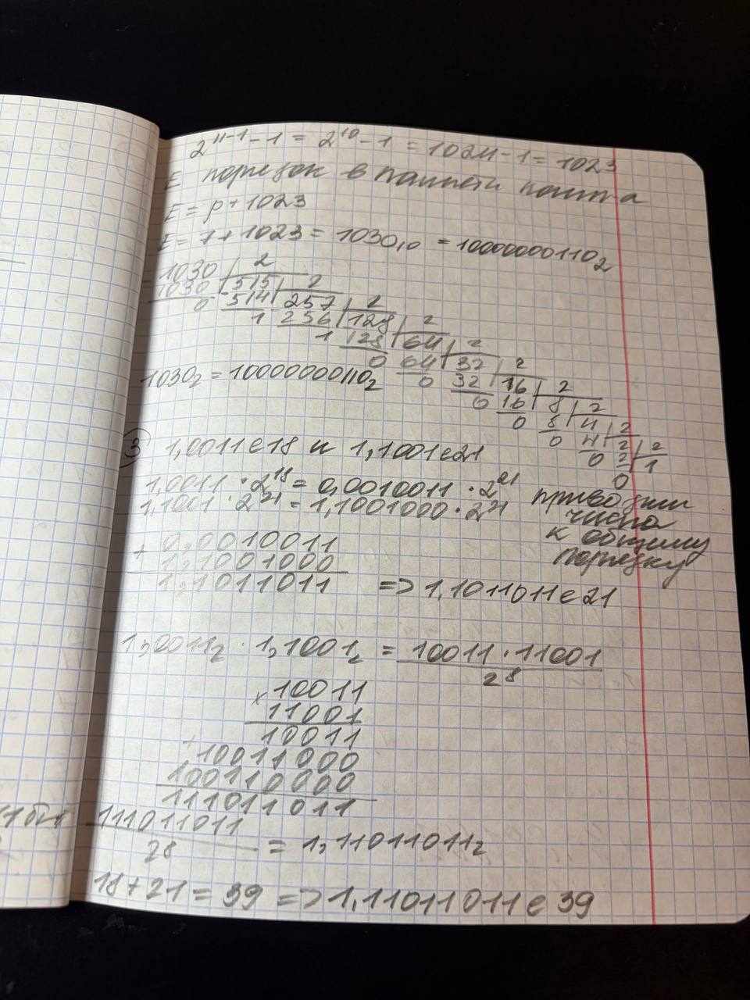
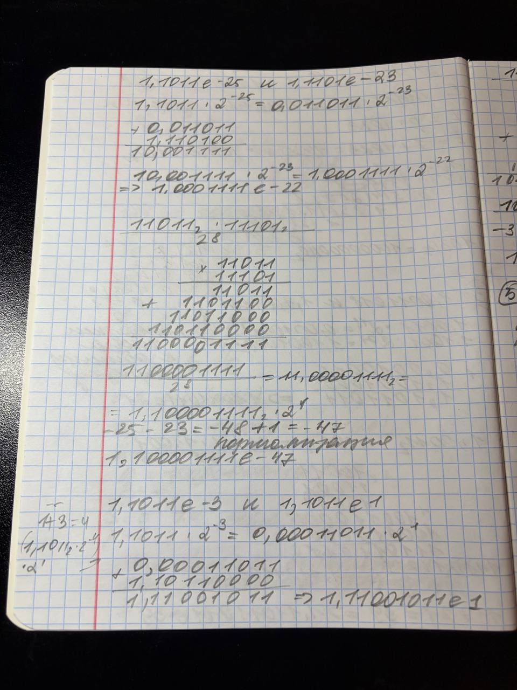
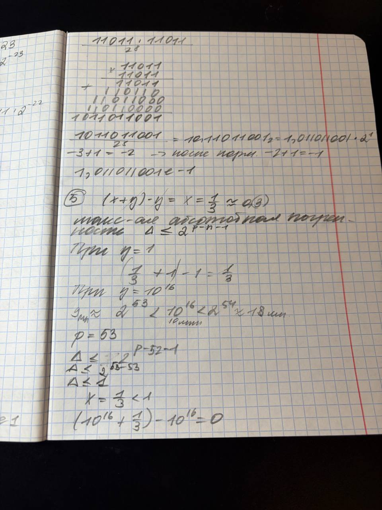

# Языки программирования
## Лабораторная работа 5

### Задание 1 **(2)**
*Переведите в двоичную запись два произвольных рациональных числа (числа вида* $\frac{p}{q}$).
*У одного из чисел знаменатель должен быть степенью двойки (32), а у другого --- некоторым числом
от 9 до 12.*

*Запись второго числа будет содержать период. Его надо найти. При решении задачи нельзя 
использовать вычислительную технику. Процесс решения должен быть представлен в отчете.*

Выбраны рациональные числа `13/32` и `5/11`.




### Задание 2 **(3)**
*Переведите в двоичную запись и найдите машинное представление в типе* **double**
*для произвольного вещественного числа большего, чем 100 с одним знаком после точки, например
для* $113.7$. *Цифра после точки не должна быть нулем иля пятеркой.*

*При решении задачи нельзя 
использовать вычислительную технику. Процесс решения должен быть представлен в отчете.*

Выбрано число `128.8` 

- Целая часть: `128 = 10000000`
- Дробная часть: `0.8 = 0.(1100)`
- Двоичная запись: `10000000.(1100)`





### Задание 3 **(3)**
*Найдите сумму и произведение для записанных далее пар чисел. Числа заданы в двоичной записи 
в экспоненциальном виде. Ответ необходимо записать в нормализованннои экспоненциальном виде.*

* 1.0011e18 и $1.1001e21;
* 1.1011e-25 и, $1.1101e-23;
* 1.1011e-3 и $1.1011e1.
  
*При решении задачи нельзя 
использовать вычислительную технику. Процесс решения должен быть представлен в отчете.*





### Задание 4 **(2)**

*Рассмотрим следующий пример в IDLE Python*
```
>>> x = 99.99
>>> int(x/10+0.001)
9
```
*Результат должен был быть равен 10, однако оказался другим. Почему так произошло?
Как исправить программу, чтобы она корректно переводила вещественные числа в целые?*

Математически `99.99 / 10 + 0.001 = 10`, однако Python получает `9.999999999999998`, функция `int()` отбрасывает дробную часть, поэтому печатается `9`
Если требуется округление к ближайшему целому, надо применять `round()`:

```
x = 99.99
print(round(x / 10 + 0.001))  # 10
```

### Задание 5. **(2)**

*Рассмотрите следующую программу. Объясните результаты ее работы. В частности,
как величина* $y$ *повлияла на ответ?*
```
x = 1/3
y = 1
for i in range(20):
    print((x+y)-y)
    y*=10
```
*В отчете требуется привести вычисления для оценки погрешности.*


### Задание 6 **(2)**

*Для какого минимального значения* $n$ *программа на С++ выведет* **inf**? *Объясните
ответ.* *Что произойдет, если тип* **double** *заменить на* **long double**?
```
int n=...;
double s = pow(2, n);
std::cout << std::fixed << s << std::endl;
```
Тип double имеет 11 бит порядка. Максимальный порядок конечного нормализованного числа равен 1023, число 2^1023 ещё можно представить в типе double, а 2^1024 уже превышает допустимый диапазон.
При переполнении получается специальное значение inf - положительная бесконечность.

Если в исходном коде заменить только `double s` на `long double s`, этого может быть недостаточно: выражение `pow(2, n)` вычисляется в типе `double`, и переполнение происходит ещё до присваивания

Чтобы вычисления выполнялись с расширенной точностью, надо передать аргумент типа `long double`:

```
int n = 1024;
long double s = std::pow(2.0L, n);
std::cout << std::fixed << s << std::endl;
```
Буква L указывает, что число 2.0L имеет тип `long double`, без неё функция pow(2, n) вычисляет результат в типе `double`

### Задание 7 **(2)**

*Допишите что-либо вместо многоточия программе на С++, чтобы программа при запуске выдавала ответ* **yes**.
```
double s = ...;
if (s != s)
  std::cout << "yes";
```

```
double s = 0.0 / 0.0;
if (s != s)
    std::cout << "yes";
```
При делении ноля на ноль в обычной арифметике IEEE 754 получается специальное значение NaN - `не число`, значение NaN не равно даже самому себе, поэтому сравнение s != s возвращает true, и программа выводит yes

### Задание 8 **(2)**

*Какое минимальное натуральное число при преобразовании в тип* **double** *записывается с погрешностью? Объясните
ответ. Почему следующее за ним число уже выводится без погрешности?*

В типе double для записи мантиссы используется 52 бита и ещё одна подразумеваемая единица. Всего получается 53 значащих бита, все натуральные числа до 2^53 включительно записываются без погрешности
Первое число, которое нельзя представить точно:

```
2^53+1=9007199254740993
```

Это число требует уже 54 значащих двоичных разряда. При округлении оно превращается в 2^53
Следующее число:

```
2^53+2=9007199254740994
```

Оно представляется точно, так как в этом диапазоне тип double может хранить целые числа с шагом 2


###  Задание 9 **(2)**
*Напишите программу для решения следующей задачи.*

*Даны четыре рациональных числа. (Рациональное число - это число вида*
$\frac{p}{q}$, *где* $p$ *и* $q$ - *целые числа.) Напишите программу, которая сравнит сумму
двух первых чисел с суммой двух последних чисел. Программа должна выводить* $1$, $0$ *или* $-1$
*в зависимости от результатов сравнения. Решение можно проверить в проверяющей системе*
[http://olymp3.isu.ru/cgi-bin/new-client?contest_id=102](http://olymp3.isu.ru/cgi-bin/new-client?contest_id=102), *задача 03*.

```
a, b = input().split()
c, d = input().split()
e, f = input().split()
g, h = input().split()
a = int(a)
b = int(b)
c = int(c)
d = int(d)
e = int(e)
f = int(f)
g = int(g)
h = int(h)
x = (a * d + c * b) * f * h
y = (e * h + g * f) * b * d
if b * d * f * h < 0:
    x = -x
    y = -y
if x > y:
    print(1)
elif x < y:
    print(-1)
else:
    print(0)
```
Программа считывает четыре рациональных числа, каждое из которых задано числителем и знаменателем. Затем вычисляет числители двух сумм после приведения дробей к общим знаменателям и сравнивает их с учётом знака знаменателей. Если первая сумма больше второй, выводится 1, если меньше -1, а если суммы равны 0. Для сравнения используются только целые числа, чтобы избежать погрешностей вычислений.

### Практикум

### Задание 1
```
n = int(input())
print(n // 15 * 15, n % 15)
```
Делим количество людей на 15, целая часть показывает число заполненных маршруток, а остаток - сколько людей не уехало

### Задание 2
```
n = int(input())
x = n
k = 1
while x > 0:
    x = x // 100
    k = k * 10
print(n // k + n % k)
```
x = n  сохраняем число для подсчёта цифр
x // 100 каждый раз убираем две последние цифры
k * 10 увеличиваем делитель в 10 раз

### Задание 3
```
n = int(input())
print(round(n / 3, 3))
```
программа делит количество воды на трёх человек и округляет результат до трёх знаков после точки

### Задание 4
```
x = float(input())
k = round(x * 100)
print(k // 100, 'руб', k % 100, 'коп')
```
Переводим всю сумму в копейки, целочисленным делением на 100 получаем рубли, а остатком - копейки

### Задание 5
```
n, m, c, k = map(int, input().split())
s = n * m - k
if s <= 0:
    print(0)
else:
    print((s + 199) // 200 * c)
```
Считаем необходимое количество листов и вычитаем уже имеющиеся, затем определяем количество пачек по 200 листов и умножаем на стоимость одной пачки

### Задание 6
```
n, m, k = map(int, input().split())
print((n * m + k - 1) // k)
```
Вычисляем общее количество конфет и определяем, сколько коробок нужно открыть, деление выполняем с округлением вверх

### Задание 7
```
n, t = map(float, input().split())
x = n * 60 / t
if x > int(x):
    print(int(x) + 1)
else:
    print(int(x))
```
программа вычисляет количество ударов сердца за минуту, если результат дробный, округляет его вверх до следующего целого числа

### Задание 8
```
x, y = map(float, input().split())
if x > y:
    x, y = y, x
a = int(x)
b = int(y)
if a < x:
    a += 1
if b > y:
    b -= 1
if a > b:
    print(0)
else:
    print(b - a + 1)
```
int(x) и int(y) получают целые части: 2 и 7
Так как 2 меньше 2.5, увеличиваем a на 1, получаем 3
Целые числа на отрезке: 3, 4, 5, 6, 7, считаем количество

### Задание 9
```
s = input()
a = 0
for i in s:
    if i in "0123456789":
        a += int(i)
print(a)
```
s = input() вводим строку
a = 0 начальная сумма
for i in s перебираем каждый символ
if i in "0123456789" проверяем, является ли символ цифрой
a += int(i) прибавляем цифру к сумме

### Задание 10
```
s = input()
a = ""
for i in s:
    if i == "(":
        a = ")" + a
    else:
        a = "(" + a
print(a)
```
s = input() вводим последовательность скобок
a = "" создаём пустую строку
for i in s перебираем скобки
if i == "(" заменяем открывающую скобку на закрывающую
else заменяем закрывающую на открывающую
a = ")" + a добавляем скобку в начало строки, поэтому порядок автоматически меняется на обратный

### Задание 12
```
a = input().split()
for i in a:
    n = int(i)
    d = 2
    while n % d != 0:
        d += 1
    print(d, end=" ")
```
input().split() разделяет введённые числа по пробелам
for i in a по очереди берёт каждое число
n = int(i) превращает его в целое число
d = 2 начинаем искать делитель с 2
while n % d != 0 пока число не делится без остатка, увеличиваем делитель
print(d, end=" ") выводим найденный делитель через пробел

### Задание 13
```
n = int(input())
s = 0
i = 1
while i < n:
    if n % i == 0:
        s = s + i
    i = i + 1
print(s)
```
n введённое число
s = 0 сумма делителей
i = 1 начинаем проверку с единицы
while i < n перебираем числа, пока i меньше n
if n % i == 0 проверяем, делится ли n на i без остатка
s = s + i добавляем найденный делитель к сумме
i = i + 1 переходим к следующему числу


### Задание 14
```
n = int(input())
m = 0
d = 0
i = 0
while i < n:
    a = int(input())
    if a % 3 == 0:
        m = m + 2
    else:
        d = d + 1
    i = i + 1
print(m, end=":")
print(d)
```
Программа считывает количество машин и с помощью цикла while по очереди проверяет их номера. Если номер машины делится на 3 без остатка, Маше начисляется 2 очка, в противном случае Даше начисляется 1 очко. После проверки каждой машины счётчик увеличивается на 1. Когда все машины проверены, программа выводит итоговый счёт Маши и Даши через двоеточие

### Задание 15
```
n = int(input())
s = 0
i = 0
while i < n:
    a, b = input().split()
    a = int(a)
    b = int(b)
    if a > b:
        s = s + a - b
    i = i + 1
print(s)
```
Программа считывает количество работ и с помощью цикла while проверяет стоимость и затраты каждой работы. Если стоимость больше затрат, разница прибавляется к общей прибыли. Убыточные работы не учитываются. После проверки всех работ программа выводит полученную сумму

## Дополнительные задания

### Задание 1 **(3)**

*Чем отличаются машинные представления чисел* $1$, $4096$, $0.0625$, *в типе* **double**? *Почему?*

### Задание 2 **(4)**
*Напишите программу для решения следующей задачи.*

*Даны четыре вещественных числа
a,b,c,d, не превосходящие 100 по модулю, записанные не более чем с 10 знаками после точки.
Требуется сравнить суммы a+b и c+d и определить, какая из них больше. Возможен случай,
что суммы будут равны.* 

*От вас требуется обосновать выбор значения* **eps** *при сравнении.*

### Задание 3 **(5)**
*Задано вещественное число в десятичной записи. Напишите программу для нахождения первых 1000 разрядов
этого числа в двоичной записи.*


### Задание 4 **(3)**
*Изучая чужой код, программист обнаружил такую функцию.*
```
long double acos_e(long double x, long double ep){
  if (x > 1+ep || x < -1-ep)
    return 0.0 / 0.0;
  else if (x>1)
    x=1;
  else if (x<-1)
    x=-1;
  return acos(x);
}
```
*Чем отличается эта функция от обычной функции арккосинуса? В чем смысл дополнительных проверок?*
### Задание 5 **(5)**
*Заданы координаты точек* $A$, $B$, $C$ *на плоскости. Координаты являются вещественными числами в диапазоне* $[0;10)$
*и содержат не более 6 знаков после точки. Используя формулу векторного произведения, напишите программу
для определения расположения* $C$ *относительно вектора* $AB$ *(слева, справа, на прямой).*

*От вас требуется обосновать выбор значения* **eps** при сравнении.*
